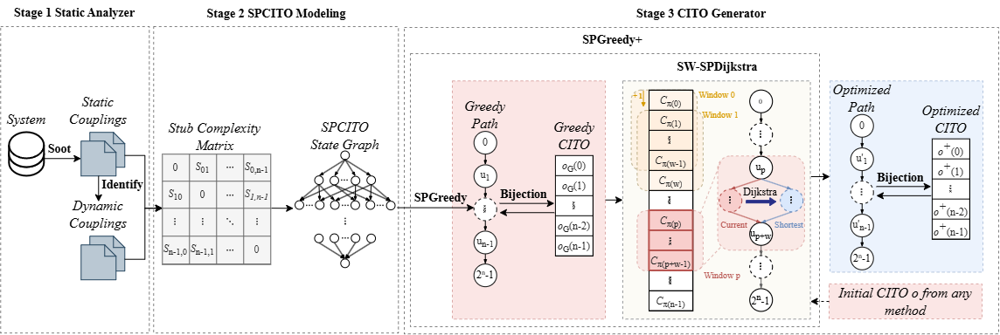

# SPCITO

Research implementation and experimental materials for **Less Is More: Reformulating Class Integration Test Order Generation as a Single-Pair Shortest-Path Problem**.



SPCITO represents class integration test orders as paths through a state graph.
The implementation provides:

- **SPDijkstra**: exact generation for tractable instances.
- **SPGreedy**: greedy construction with uniform random selection among minimum-cost ties.
- **SW-SPDijkstra**: exact optimization within consecutive sliding windows of an existing order.
- **SPGreedy+**: SPGreedy construction followed by SW-SPDijkstra.

The repository includes the proposed methods, experiment runners, Ding benchmark
inputs, experimental records, and Markdown result reports. External baseline
implementations are not bundled. Their recorded outputs cover LeTraon, GA, RIA,
PSO, and the DQN, PPO, and A2C variants of DyCITO+.

## Running experiments

Run the commands below from the repository root. Default input paths are
resolved relative to the repository; explicit command-line paths are resolved
relative to the current working directory.

### Generate orders

Generate one SPGreedy+ order for Ant:

```sh
python experiments/run_generation.py --algorithm SPGreedy+ --project-dir datasets/Ding/ANT --runs 1 --window-size 10
```

Run all eight Ding projects 30 times each:

```sh
python experiments/run_generation.py --algorithm SPGreedy+ --dataset-root datasets/Ding --runs 30 --window-size 10
```

Use `--algorithm SPGreedy` for construction alone or `--algorithm SPDijkstra`
for exact generation on a tractable project. The exact solver has exponential
state-space growth; `--max-exact-classes` is a practical size guard.
`--worker-timeout` limits the complete worker lifetime, including preparation
and warmup, rather than the measured algorithm time.

Each batch creates a timestamped directory under `result/raw/generation/`.
Keep its `configuration.json`, `runs.csv`, and `summary.csv`: they contain the
seed plan, complete orders, scores, resource measurements, and execution settings.

### Optimize a supplied order

Save a complete zero-based permutation in `initial_order.json`. For example,
an Ant input containing all 25 classes is:

```json
[3,0,2,1,4,5,6,7,8,9,10,11,12,13,14,15,16,17,18,19,20,21,22,23,24]
```

Run standalone SW-SPDijkstra on that order:

```sh
python experiments/run_generation.py --algorithm SW-SPDijkstra --project-dir datasets/Ding/ANT --initial-order initial_order.json --window-size 10 --runs 1 --output-dir result/raw/postoptimization
```

The timestamped output contains `runs.csv` with the optimized order, scores,
runtime, and memory. The measured time excludes generation of the supplied order.
Change both the project directory and the permutation when using another project.

### Optimize recorded orders

Optimize the recorded orders under `result/processed/Ding/`:

```sh
python experiments/run_postoptimization.py --window-size 10
```

For only the Sequential reference:

```sh
python experiments/run_postoptimization.py --algorithms Sequential --window-size 10
```

Each selected input record is optimized once. SPGreedy+ inputs are excluded.
The existing 30 orders per project and method are not each repeated another
30 times. Sequential is the ascending matrix-index order `[0,1,...,n-1]`;
its 30 copies per project repeat the same input for resource measurement.

Outputs are saved under `result/raw/postoptimization/<timestamp>/`.
Input method `A` produces `<Project>_<A>+.csv`. The batch also retains
`paired_runs.csv` and its configuration, including the original orders,
before/after scores, source identities, and measurement details.

### Sweep window sizes

```sh
python experiments/run_window_sweep.py --dataset-root datasets/Ding --runs 1 --warmup-runs 1
```

The default sweep uses window sizes 1 through 18. Every setting restarts from
the original Sequential order rather than a previous setting's output.
New batches are written under `result/raw/window_size/`. The archived sweep
contains one measured run after one warmup for each of 144 project/window
combinations. Additional resource repetitions can be requested with `--runs`.
The sweep saves its original input orders and settings with the new batch.

A small sweep can be run with:

```sh
python experiments/run_window_sweep.py --dataset-root datasets/Ding --projects ANT --windows 1 2 --runs 1 --warmup-runs 0
```

### Run implementation tests

```sh
python -m unittest discover -s experiments/tests -v
```

The tests cover small synthetic instances, the eight-system Ding regression
fixture, worker isolation, and measurement boundaries. They do not regenerate
the archived 30-run campaigns.

## Measurement and repeated experiments

These definitions apply to the SPCITO experiment runners included here.

### Runtime

`RuntimeMs` is elapsed algorithm time in milliseconds, measured with
`time.perf_counter_ns()`. It includes preprocessing, search, window optimization,
and order recovery. It excludes process startup, input loading, warmup,
independent score evaluation, and result writing. SPGreedy+ records total time
for both stages and the separate construction and optimization times.

### Memory

`PeakRSSMiB` is the worker process's highest resident memory usage up to the
measurement query, in MiB (1 MiB = 1,048,576 bytes). It includes the interpreter,
input matrices, warmup, algorithm execution, scoring, and result preparation.
It measures process memory rather than exclusive algorithm auxiliary space.
SPGreedy+ records the complete worker's peak, not the sum of two stage peaks.

### Repeated runs

Each recorded run uses a fresh worker process, and runs are executed sequentially.
Order generation defaults to 30 runs per project; the window sweep defaults to
one run per project and window size. Both accept `--runs`. Postoptimization
processes each selected input record once. All runners default to one untimed
warmup per worker, adjustable with `--warmup-runs`.

### Random seeds

By default, generation batches draw unique random 64-bit seeds from the operating
system and save the seed plan before execution. Each run also records its seed.
SPGreedy selects uniformly among equal minimum-cost choices, and SPGreedy+
inherits this randomness. Warmup and measured calls initialize separate random
generators with the same recorded seed.

Replay one run for one project with the same inputs and software versions:

```sh
python experiments/run_generation.py --algorithm SPGreedy+ --project-dir datasets/Ding/ANT --runs 1 --seed 117 --window-size 10
```

`117` is an example replay seed, not the default for new batches. SPDijkstra
and SW-SPDijkstra are deterministic for fixed inputs and settings. Repeating
optimization of the same input measures resource variation, not independent
order-quality samples. Timing and memory can vary between runs.

## Data and experimental results

### Input and scoring conventions

`datasets/Ding/` contains the eight Ding systems used by the experiments.
Each project supplies `StubComplexityMatrix.csv` and `DependencyMatrix.csv`.
Orders are complete permutations of matrix indices `0` through `n-1`.
`CId_Name.csv` maps class IDs to names; its rows need not be sorted, so use
the ID field rather than the mapping file's row position. Sequential follows
matrix indices, not alphabetical class-name order.

For a client integrated before its provider, `Ocplx` adds the corresponding
cost-matrix entry and `SStubs` counts the dependency pair, including zero-cost
dependencies. The same benchmark matrices are used across methods.

### Recorded files

| Directory | Contents |
| --- | --- |
| `result/raw/generation/` | Original LeTraon, search, RL, and SPGreedy+ generation records, with available configurations and summaries. |
| `result/raw/postoptimization/20260914_195158_722446/` | 1,920 standalone optimization records: 8 initial methods, 8 projects, and 30 input orders per combination. |
| `result/raw/postoptimization/20260915_205005_164034/` | 240 Sequential optimization resource measurements: 8 projects and 30 repetitions of the same input per project. |
| `result/raw/window_size/` | The 8-project, 18-window sweep, with one measured run per setting. |
| `result/processed/Ding/` | 80 standardized CSVs: 8 projects, 10 methods/references, and 30 rows per file. |
| `result/RQ1/` through `result/RQ4/` | One Markdown result report per research question. |

The collected raw and processed records retain their original file contents.
The standardized files were previously normalized and rescored; they are not
the untouched original outputs of each baseline implementation.

### Standardized result schema

```text
Run,Project,Algorithm,CITO,Ocplx,SStubs,RuntimeMs,PeakRSSMiB
```

| Field | Definition |
| --- | --- |
| `Run` | Recorded repetition number, 1 through 30; not a random seed. |
| `Project` | Project directory identifier. |
| `Algorithm` | Method/reference name. SPGreedy+ uses filename suffix `SPGreedyPlus` and algorithm value `SPGreedy+`. |
| `CITO` | JSON list containing the complete zero-based class permutation. |
| `Ocplx` | Total stubbing complexity from the common cost matrix. |
| `SStubs` | Specific stub count, including zero-cost dependencies. |
| `RuntimeMs` | Recorded runtime in milliseconds. |
| `PeakRSSMiB` | Recorded process memory in MiB. |

Sequential generation time and memory were not measured, so those fields are
blank. Missing values are not zeros. Original seed information, where available,
remains alongside the raw records in their batch configurations.

SPGreedy records are the construction-stage reference from SPGreedy+ before
window optimization. Standalone postoptimization records measure optimization
of an existing order, not initial generation plus optimization. Memory peaks
cannot be added across stages or separate processes.

### Result reports

| Research question | Report |
| --- | --- |
| RQ1 | [Statistical results](result/RQ1/RQ1_statistical_results.md) |
| RQ2 | [Postoptimization results](result/RQ2/RQ2_statistical_results.md) |
| RQ3 | [Window-size results](result/RQ3/RQ3_results.md) |
| RQ4 | [Computational overhead](result/RQ4/RQ4_results.md) |

RQ1 compares nine methods, excluding Sequential. RQ2 reports paired before/after
observations and describes Sequential quality separately. RQ3 uses the fixed-input
window sweep. RQ4 summarizes the recorded time and memory values.

Only the Markdown reports are retained in the four RQ directories. Figure
exports, LaTeX fragments, summary CSVs, and analysis JSON files are not retained
in those four directories. Statistical analysis and plotting scripts are not
bundled. The underlying records remain in `result/raw/` and `result/processed/`.

Keep new batches separate from archived records when environments or measurement
definitions differ. Rerunning external baselines requires their implementations
and environments. Historical absolute paths, source hashes, and older RQ names
in configurations are provenance, not dependencies on the original machine.

## Directory layout

```text
src/SPCITO/                 Core algorithms and common scoring
experiments/                Generation, postoptimization, and window sweeps
experiments/measurement/    Worker isolation and resource measurement
datasets/Ding/              Eight Ding systems and their experimental matrices
result/raw/                 Original records and execution configurations
result/processed/           Standardized and rescored records
result/RQ1/ ... result/RQ4/  One Markdown result report per research question
```
